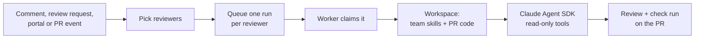

# How a review runs

1. **Pick reviewers.** See [Calling Chakshu](calling-chakshu.md).
2. **Queue.** Each reviewer gets a row in the `runs` table, which is also the job queue.
3. **Claim.** A worker takes the oldest queued run (`FOR UPDATE SKIP LOCKED`, so several workers never take the same one) and opens a check run called **Chakshu · &lt;reviewer&gt;**.
4. **Still current?** If the pull request has moved to a newer commit, the run is cancelled and the check says so. Ask again for the new commit.
5. **Build a workspace.** Chakshu checks out the reviewer at the commit it was synced from, and the pull request at its head commit. The team's skills go into `.claude/skills/` and its rules into `CLAUDE.md`. In the PR's copy it deletes `CLAUDE.md`, `CLAUDE.local.md`, `AGENTS.md`, `.claude/` and `.mcp.json` at any depth, plus `.git` and symlinks that point outside the checkout.
6. **Review.** The agent runs in that folder with only `Read`, `Grep`, `Glob` and `Skill`. It has no shell, no web access and no GitHub token, and it loads no settings other than the workspace's. It stops at the reviewer's cost cap and returns a summary and findings as structured JSON.
7. **Publish.** Findings below `min_severity` are dropped and the rest are capped at `max_findings`. Findings already posted on this PR are skipped. Each carries a hidden ID made from the file, category and title, so an unrelated edit doesn't make it look new. The rest go out as one review: inline comments with suggestions where the agent offered a fix, and anything outside the changed lines in the summary.
8. **Tidy up.** Chakshu resolves its own earlier threads when GitHub marks them outdated (the code under them changed) and the finding didn't come back in this review. Threads people started are never touched.
9. **Finish.** The check run completes: failure if any finding reaches `fail_check_on`, success otherwise. Cost, duration and findings are saved on the run, and a pending `chakshu` review request is cleared.

## Later reviews of the same PR

When a reviewer already reviewed the pull request at an earlier commit, the next review gets only the diff since then, plus the list of every file the PR touches so the agent can read them for context. A force push falls back to a full review. The run page says "Reviewed only the changes since …" when this happens.

## Webhooks

`web` only checks a webhook's signature and stores it in the `webhook_events` table; the worker handles it. A restart of either process doesn't lose events. GitHub redeliveries are dropped by delivery ID. A webhook that fails three times shows on the **Status** page with its error, and admins can retry it there.

## When something goes wrong

- GitHub 5xx and rate-limit responses, network errors and git errors are retried, up to three attempts in total.
- Anything else fails the run. The error shows on the run page, and the check completes as neutral with the reason.
- Workers send a heartbeat for the jobs they hold every 20 seconds. If a worker dies, any other worker requeues its jobs within about two minutes.
- On `docker compose stop` the worker stops taking new work and gives running reviews up to nine minutes to finish. Anything still unfinished goes back to the queue, and that interrupted attempt doesn't count.

## What stops a hostile pull request

- The reviewer's instructions come only from the reviewers repo, never from the PR.
- The PR's title, description, diff and the requester's note are fenced as untrusted data, and the agent is told not to follow instructions inside them.
- The agent can read files and nothing else. Even if text in the PR talks it into trying something, it has no tool to do it with.
- Write access to GitHub is used only by the publishing step, which is plain code that treats the agent's output as data.
