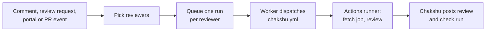

# How a review runs

1. **Pick reviewers.** See [Calling Chakshu](calling-chakshu.md).
2. **Queue.** Each reviewer gets a row in the `runs` table, which is also the job queue.
3. **Dispatch.** A worker takes the oldest queued run, opens a check run called **Chakshu · &lt;reviewer&gt;** and starts `.github/workflows/chakshu.yml` in the pull request's repository with `workflow_dispatch`. GitHub returns the Actions run it started. Chakshu stores it, and the check's **Details** link points to it. The run is now **dispatched**.
4. **Still current?** If the pull request has moved to a newer commit before the review starts, the run is cancelled and the check says so. Ask again for the new commit.
5. **Fetch the job.** The runner checks out the pull request and asks Chakshu for its job, signing the request with the Actions run's OIDC token. Chakshu only answers the exact Actions run it started, from `chakshu.yml`, while the review is still waiting. Repositories hold no Chakshu secret. The job carries the prompt, the reviewer's skills and `CLAUDE.md` (from the reviewer at the commit it was synced from), and the definitions of its connector tools.
6. **Build a workspace.** On the runner, the team's skills go into `.claude/skills/` and its rules into `CLAUDE.md`. In the pull request's copy it deletes `CLAUDE.md`, `CLAUDE.local.md`, `AGENTS.md`, `.claude/` and `.mcp.json` at any depth, plus `.git` and symlinks that point outside the checkout.
7. **Review.** The agent runs with only `Read`, `Grep`, `Glob` and `Skill`, plus the reviewer's [connector](connectors.md) tools. It has no shell, no web access and no GitHub token, and it loads no settings other than the workspace's. Connector calls go back to Chakshu, which runs them with the stored credentials. The Actions log shows every tool call as it happens. The agent stops at the reviewer's cost cap and returns a summary and findings as structured JSON. The job also writes a summary with the findings to the Actions run page.
8. **Report back.** The runner sends the result, or the reason it failed, to Chakshu.
9. **Publish.** Chakshu posts as its GitHub App. Findings below `min_severity` are dropped and the rest are capped at `max_findings`. Findings already posted on this PR are skipped. Each carries a hidden ID made from the file, category and title, so an unrelated edit doesn't make it look new. The rest go out as one review: inline comments with suggestions where the agent offered a fix, and anything outside the changed lines in the summary.
10. **Tidy up.** Chakshu resolves its own earlier threads when GitHub marks them outdated (the code under them changed) and the finding didn't come back in this review. Threads people started are never touched.
11. **Finish.** The check run completes: failure if any finding reaches `fail_check_on`, success otherwise. Cost, duration and findings are saved on the run, and a pending `chakshu` review request is cleared.

## Later reviews of the same PR

When a reviewer already reviewed the pull request at an earlier commit, the next review gets only the diff since then, plus the list of every file the PR touches so the agent can read them for context. A force push falls back to a full review. The run page says "Reviewed only the changes since …" when this happens.

## Replies

When someone replies to one of Chakshu's comments, the same machinery runs a short reply job. See [Replies](replies.md).

## Webhooks

`web` only checks a webhook's signature and stores it in the `webhook_events` table; the worker handles it. A restart of either process doesn't lose events. GitHub redeliveries are dropped by delivery ID. A webhook that fails three times shows on the **Status** page with its error, and admins can retry it there.

## When something goes wrong

- GitHub 5xx and rate-limit responses and network errors while dispatching are retried, up to three attempts in total.
- If the repository has no Chakshu workflow, or the app may not start workflows, the check says so and names the fix.
- If the Actions run ends without sending a result (cancelled, timed out, couldn't reach Chakshu), the `workflow_run` event fails the review with that reason. As a fallback, Chakshu gives up on reviews that haven't reported back after 45 minutes.
- If posting fails after a review, the runner retries. Posting is safe to repeat because findings carry IDs.
- Workers send a heartbeat for the jobs they hold every 20 seconds. If a worker dies, any other worker requeues its jobs within about two minutes.

## What stops a hostile pull request

- The reviewer's instructions come only from the reviewers repo, never from the PR.
- The workflow always runs from the repository's default branch, so a pull request can't change what the review job does.
- The PR's title, description, diff and the requester's note are fenced as untrusted data, and the agent is told not to follow instructions inside them.
- The agent can read files and nothing else. Even if text in the PR talks it into trying something, it has no tool to do it with. The runner removes the OIDC request credentials from the environment before the agent starts.
- Write access to GitHub is used only by Chakshu's publishing step, which is plain code that treats the agent's output as data.
