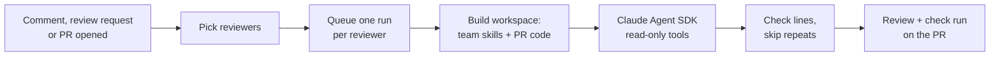

# How a review runs

!!! warning "Planned"
    This describes the review pipeline as designed.

1. **Pick reviewers.** See [Calling Chakshu](calling-chakshu.md).
2. **Queue.** Each reviewer gets a row in the `runs` table, which is also the job queue. A second request for the same reviewer, PR and commit is ignored. Each reviewer gets its own check run, for example "Chakshu · payments-reviewer".
3. **Build a workspace.** Chakshu creates a temporary folder and copies in the reviewer's skills and rules from the reviewers repo. Then it shallow-clones the PR's head commit into `code/` and deletes any `.claude/`, `CLAUDE.md` or `AGENTS.md` from that copy. Only your team's files can give the reviewer instructions; the pull request can't.
4. **Review.** The Claude Agent SDK runs in that folder with only `Read`, `Grep`, `Glob` and `Skill`. It has no shell, no network tools and no GitHub token. It stops at the reviewer's cost cap and returns findings as structured JSON.
5. **Publish.** Findings on lines outside the diff move to the summary, because GitHub rejects comments there. Findings already posted on an earlier run are skipped. The rest go out as one review with inline comments and suggestions, and the check run completes.

## What stops a hostile pull request

- The reviewer's instructions come only from the reviewers repo, never from the PR.
- The agent can read files and nothing else. Even if the PR's text convinces it to try something, it has no tool to do it with.
- Write access to GitHub is held by the publishing step, which runs plain code that never sees model output as instructions.
