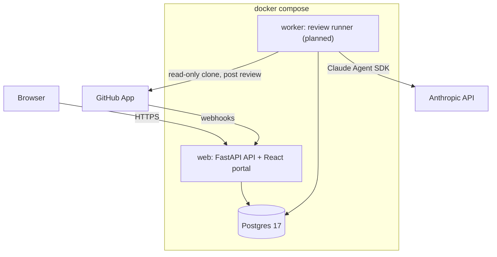

# Architecture



The app is one Python codebase that runs as two processes from the same image: `web` (portal, API, webhooks) and `worker` (reviews). Postgres holds settings, a cache of reviewers, and the runs table, which doubles as the job queue (`SELECT … FOR UPDATE SKIP LOCKED`). There's no Redis and no message broker.

## Stack

| Part | Choice |
|---|---|
| API | Python 3.12, FastAPI, Pydantic Settings |
| Data | PostgreSQL 17, SQLAlchemy 2 (async, asyncpg), Alembic |
| Portal | React 19, TypeScript, Vite, Tailwind v4, shadcn/ui, TanStack Query |
| GitHub | githubkit (App auth, installation tokens, webhooks) |
| Reviews | Claude Agent SDK |
| Secrets | Fernet, key derived with HKDF from `CHAKSHU_SECRET_KEY` |
| Packaging | Multi-stage Docker image, docker compose |

## Code layout

```text
src/chakshu/
  api/        HTTP routes. Thin: parse, call a service, return JSON.
  handlers/   One module per GitHub webhook event.
  services/   Logic that touches the database, GitHub or the model.
  helpers/    Pure functions, no I/O.
  db/         Models, session, migrations.
  core/       Settings, logging, IDs, crypto.
frontend/src/
  pages/      One file per screen.
  components/ Layout and shadcn/ui components.
  lib/        API client and utilities.
```

## Data

| Table | Holds |
|---|---|
| `settings` | Portal settings; secrets encrypted |
| `installations` | GitHub App installations |
| `users` | People who sign in |
| `repos` | Repos the app can see |
| `reviewers` | Cache of each `reviewer.yaml` and the commit it came from |
| `runs` | One reviewer × one PR × one commit; also the job queue |
| `webhook_deliveries` | Handled delivery IDs, for deduplication |
