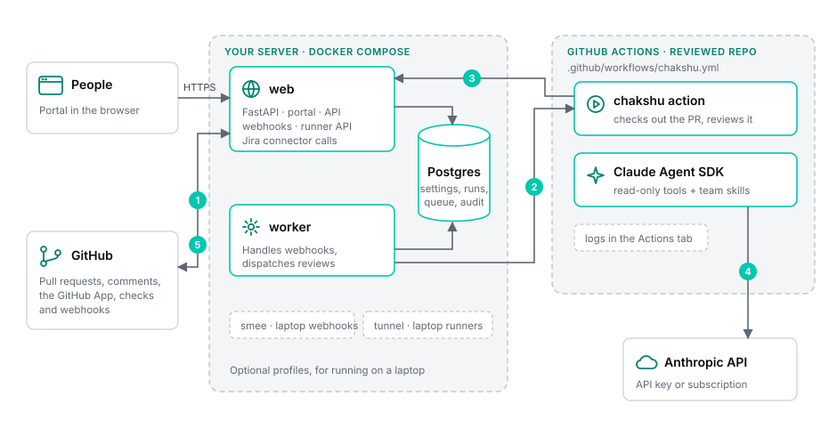
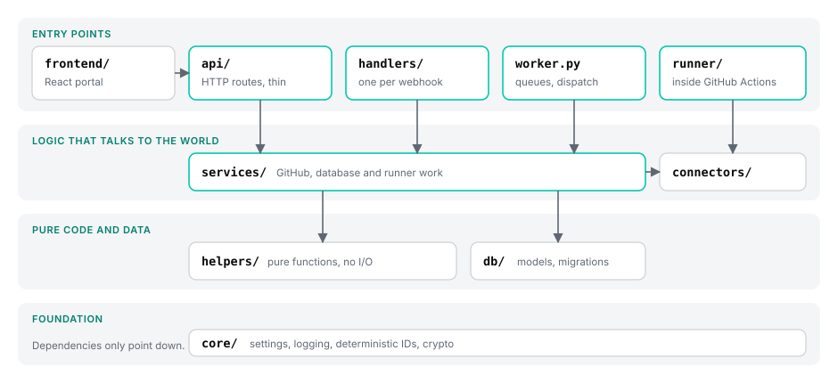

# Architecture

Chakshu is one Python codebase. On your server it runs as two processes, `web` and `worker`, next to Postgres. Each review runs somewhere else: on a GitHub Actions runner in the repository being reviewed, so the server stays small and the logs sit in that repository's Actions tab.

{ .diagram }

1. **Ask.** Someone mentions `@org/chakshu` or requests it as a reviewer, and GitHub sends a webhook to `web`. The portal's Review button skips this step.
2. **Dispatch.** The `worker` picks the reviewers and starts `.github/workflows/chakshu.yml` in that repository with `workflow_dispatch`.
3. **Fetch the job.** The runner proves which run it is with its OIDC token and gets the prompt, the reviewer's skills and its connector tools from `web`.
4. **Review.** Claude reads the pull request with read-only tools. Connector calls such as Jira go back to `web`, so their credentials never leave the server.
5. **Post.** The runner sends the findings to `web`, which posts the review and the check run as the GitHub App.

There's no Redis and no message broker. Postgres holds settings, a cache of each organization's reviewers, and the `runs` table, which is also the job queue.

## Stack

-   :material-api:{ .lg } **API**

    Python 3.12, FastAPI, Pydantic Settings, signed-cookie sessions

-   :material-database-outline:{ .lg } **Data**

    PostgreSQL 17, SQLAlchemy 2 (async, asyncpg), Alembic

-   :material-monitor-dashboard:{ .lg } **Portal**

    React 19, TypeScript, Vite, Tailwind v4, shadcn/ui, TanStack Query

-   :material-github:{ .lg } **GitHub**

    githubkit for the app, installation, OAuth and user clients, and webhook checks

-   :material-creation-outline:{ .lg } **Reviews**

    Claude Agent SDK on GitHub Actions runners

-   :material-lock-outline:{ .lg } **Secrets**

    Fernet, with a key derived by HKDF from `CHAKSHU_SECRET_KEY`

## How the code is layered

{ .diagram }

Routes stay thin: they check input, call a service and return JSON. Anything that touches GitHub, the database or a runner lives in `services/`. Anything that can be a pure function lives in `helpers/`, where it's easy to test.

## Code layout

`src/chakshu/` holds the server and the runner. `frontend/src/` holds the portal.

| Folder | What lives there | Examples |
|---|---|---|
| `api/` | HTTP routes for the portal, webhooks and runners | `runner.py`, `analytics.py`, `repos.py` |
| `handlers/` | One module per GitHub webhook event | `issue_comment.py`, `workflow_run.py` |
| `worker.py` | The worker loop: webhook queue, dispatch, maintenance | |
| `services/` | Work that talks to GitHub, the database or a runner | `dispatcher.py`, `jobs.py`, `review_results.py`, `repo_setup.py`, `analytics.py` |
| `runner/` | What runs inside GitHub Actions | `protocol.py`, `client.py`, `engine.py` |
| `connectors/` | Connector kinds and the bridge that forwards tool calls | `jira.py`, `bridge.py` |
| `helpers/` | Pure functions with no I/O | `selection.py`, `prompt.py`, `findings.py`, `workspace.py` |
| `db/` | Models, sessions and migrations | `models.py`, `migrations/` |
| `core/` | Settings, logging, deterministic IDs, crypto | `config.py`, `ids.py` |
| `templates/` | The workflow file Chakshu proposes to repositories | `chakshu.yml` |
| `frontend/src/pages/` | One file per portal screen | `analytics-page.tsx`, `repo-page.tsx` |
| `frontend/src/components/` | Shared pieces and shadcn/ui components | `analytics-charts.tsx`, `ui/` |
| `frontend/src/lib/` | API client and formatting | `api.ts`, `format.ts` |

## Data

| Table | Holds |
|---|---|
| `settings` | Portal settings; secrets encrypted |
| `installations` | GitHub App installations |
| `users` | People who sign in |
| `repos` | Repositories the app can see, and whether reviews are on |
| `reviewers` | Cache of each `reviewer.yaml`, the commit it came from and any errors |
| `runs` | One reviewer, one pull request, one commit (or one reply), with its Actions run; also the job queue |
| `posted_findings` | Findings Chakshu posted and what became of them |
| `connectors` | Outside systems reviewers can read; credentials encrypted |
| `webhook_events` | Webhooks waiting for or handled by the worker, keyed by delivery ID so redeliveries are dropped |
| `analytics_audit` | Who viewed or exported analytics about named people |

Every primary key is a [deterministic ID](../reference/ids.md).
